<picture>
  <source media="(prefers-color-scheme: dark)" srcset="./assets/header-dark.svg">
  
</picture>

  <strong>Investigate with curiosity. Test with permission. Build with purpose.</strong>

  <a href="#about-me">About</a> ·
  <a href="#skills--toolkit">Skills &amp; toolkit</a> ·
  <a href="#featured-projects">Projects</a> ·
  <a href="#github-activity">Activity</a>

## About me

I'm **Muhammad Mohib**, a **7th-semester Cyber Security student** with hands-on academic and CTF experience. I'm interested in penetration testing, ethical hacking, digital forensics, cryptography, and building practical security tools.

- **Current work:** a cryptography solver, digital forensic utilities, and an **EEG-based Stress Detection & IoMT Security** final-year project.
- **CTF practice:** challenges in cryptography, steganography, forensics, and web security.
- **Career objective:** grow into a cybersecurity role where I can investigate threats, assess vulnerabilities responsibly, and develop tools that support security teams.
- **Looking ahead:** internships, early-career opportunities, and collaboration on security projects and CTF learning.

## Skills & toolkit

### Security tools

Tools I've practiced with through academic work and CTF challenges:

  
  
  
  
  
   
  
  
  
  
  

### Programming & scripting

  
  
  

### Cybersecurity domains

| Focus | Interests & practice |
| :--- | :--- |
| **Offensive security** | Penetration testing, ethical hacking, and web security CTF practice |
| **Forensics & hidden data** | Digital forensics, steganography, and forensic utility development |
| **Cryptography & tooling** | Cryptography challenges, solver development, and security scripting |

### Currently learning

  
  
  

I'm also exploring **reverse engineering** and **binary exploitation**, while deepening my understanding of **digital forensics, cryptography, and steganography**.

## Featured projects

- **Cryptography solver & forensic utilities** · In development 
  Developing tools for cryptography and digital forensic work.
- **EEG-based Stress Detection & IoMT Security** · In progress 
  My final-year project on stress detection and IoMT security.
- **[Sentin-AI](https://github.com/Mohib235037/Sentin-AI)** · Repository created 
  Public repository; code and documentation have not been published yet.

[Explore my repositories →](https://github.com/Mohib235037?tab=repositories)

## GitHub activity

  <a href="https://github.com/Mohib235037?tab=overview">
    <picture>
      <source media="(prefers-color-scheme: dark)" srcset="https://github-profile-summary-cards.vercel.app/api/cards/stats?username=Mohib235037&amp;theme=github_dark">
      
    </picture>
  </a>

<picture>
  <source media="(prefers-color-scheme: dark)" srcset="https://github-readme-activity-graph.vercel.app/graph?username=Mohib235037&amp;bg_color=0b1424&amp;color=a3b4c9&amp;line=2dd4bf&amp;point=2dd4bf&amp;area=true&amp;area_color=164e4a&amp;hide_border=true&amp;radius=12&amp;custom_title=Contribution%20Activity">
  
</picture>

  Live activity graphics are provided by GitHub Profile Summary Cards and GitHub Readme Activity Graph. 
  <a href="https://github.com/Mohib235037?tab=overview">View my GitHub contribution calendar →</a>

---

  <strong>Let's connect through security, research, and building useful tools.</strong> 
  <a href="https://github.com/Mohib235037">@Mohib235037</a>

